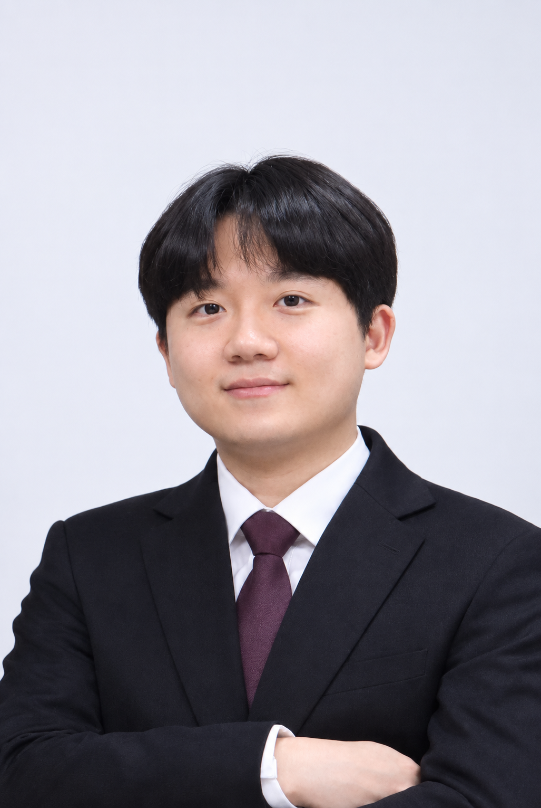

  

  <h2>Minwoo Wang</h2>
  
Undergraduate student at Korea University, Seoul. 
     Major in Physics with a double major in Electrical and Electronic Engineering. 

**Physics Undergraduate · Scientific Computing · Detector Simulation**

I am an undergraduate student at Korea University studying Physics and Electrical and Electronic Engineering. My research experience focuses on experimental particle physics, detector simulation, and scientific programming. I use Python and Linux-based tools to process experimental data, develop analysis workflows, and study charged-particle behavior in detector systems.My research interests include experimental particle physics, detector simulation, and scientific computing. I have experience with Garfield++, Geant4, Python, and ROOT for simulation and experimental data analysis.

## About

### Research Interests

My interests lie at the intersection of experimental physics and computational methods, particularly:

- Detector physics and instrumentation
- Particle transport and detector simulation
- Scientific computing and data analysis
- Python development and Linux-based research workflows

### Technical Skills

- **Programming:** Python
- **Simulation:** Garfield++, Geant4
- **Scientific data:** ROOT, binary-data processing, data visualization
- **Environment:** Linux, Ubuntu

## Education

### 2022 — PRESENT | Korea University

**Undergraduate Studies in Physics**  
Second major in **Electrical and Electronic Engineering**, entered in September 2023.

Currently on a leave of absence from undergraduate studies. Degree not yet completed.

## Research Experience

### December 2023 — PRESENT | Stellar Nucleosynthesis Reaction Research Group, Korea University

**Research Group Member**  
Research supervisor: Professor Ahn Jung-geun

- Conducted electron-transmission simulations through a gating GEM using **Garfield++** on Ubuntu Linux.
- Developed Python code to calculate electron transmission rates and associated errors.
- Generated and analyzed *Transmission Rate vs. ΔV across GEM* plots.
- Presented a research poster at the **2024 Korean Physical Society (KPS) meeting**: “Garfield simulation on a gating GEM operation for COREA” (P1-nu.013, October 23, 2024).

### June 2023 — August 2023 | High Energy Experimental Laboratory, Korea University

**Research Assistant — Data Processing and Calibration**  
Research supervisor: Professor Yoo Jae-hyeok  
(*Millicharged Particle Search Laboratory*)

- Developed Python code to parse header information from binary data files, organize the information into a tree structure, and save it in ROOT format.
- Developed Python code for time calibration to correct timing differences across 16 parallel data channels.

### June 2023 — November 2024 | Early Universe Research Laboratory, Korea University

**Research Group Affiliation**  
Research supervisor: Professor Won Eun-il.

### March 2023 — July 2023 | Detector Fabrication Laboratory, Korea University

**Research Group Affiliation**  
Research supervisor: Professor Lee Kyung-se, Korea Detector Laboratory.

## Projects

### Garfield++ Simulation of Electron Transmission Through a Gating GEM

Simulated electron transmission through a gating Gas Electron Multiplier (GEM) using Garfield++ in an Ubuntu Linux environment. Developed Python analysis code to calculate transmission rates and errors, and to visualize the relationship between transmission rate and the voltage difference across the GEM.

**Tools:** Garfield++, Python, Ubuntu Linux, Data Visualization

### C3+ Ion Beam Trajectory Optimization with Geant4

Worked on a simulation to optimize the trajectory of a C3+ (triply charged carbon) ion beam using Geant4 in a Linux-based Ubuntu environment.

**Tools:** Geant4, Linux, Ubuntu

### Binary Data Processing and 16-Channel Time Calibration

Built Python tools for experimental data processing: extracted header information from binary files, organized it into a tree structure, exported the result to ROOT files, and developed a time-calibration workflow to correct timing offsets across 16 parallel channels.

**Tools:** Python, ROOT, Binary Data Processing, Time Calibration

## Publications

No peer-reviewed publications have been listed yet.

## Presentations

### October 23, 2024 | Korean Physical Society Meeting

**“Garfield simulation on a gating GEM operation for COREA”**  
Poster presentation · P1-nu.013

## Photos

This section is reserved for research, conference, laboratory, and profile photos.

To add a photo later, upload the image to the repository (for example, into an `assets/photos/` folder) and add it here using Markdown:

``

## Leadership

Leadership, mentoring, and service experience can be added to this section.

## Files

This section is reserved for documents and downloadable materials, such as a CV, research poster, publications, or project reports.

To add a file later, upload it to the repository (for example, into an `assets/files/` folder) and add a link here:

`[Download document](assets/files/your-document.pdf)`

## Contact

Based in **South Korea**.

Contact details and professional links will be added here.

---

*This portfolio summarizes the academic and research experience documented in my career certificate. Personal identification details, including date of birth and residential address, are intentionally not published.*
